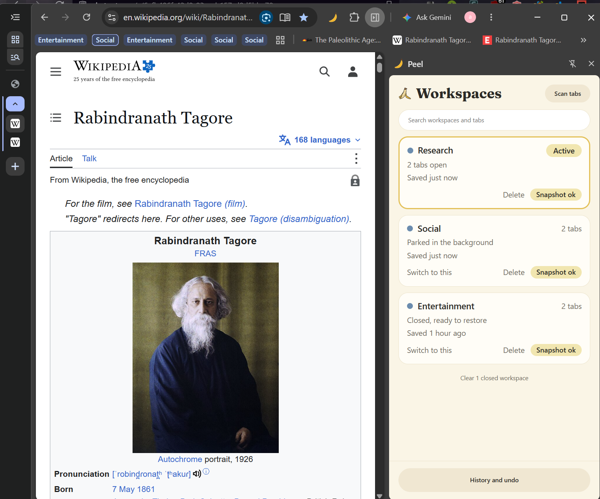

# Peel

**Too many tabs? Give them a peel.**

Peel is a Chrome extension that helps you organize your tabs into workspaces, switch between them, and pick up from where you left off without having 50 tabs cluttering your browser.

## Try Peel

[Download the latest release](https://github.com/4nav/peely/releases/latest)

## Installation

1. Download the latest ZIP from [GitHub Releases](../../releases).
2. Extract the ZIP somewhere on your computer.
3. Open `chrome://extensions` in Chrome.
4. Enable **Developer mode**.
5. Click **Load unpacked**.

## Features

- **Workspaces:** Make separate spaces for different projects, tasks, or whatever else you have going on.
- **Tab Groups:** Automatically organize related tabs into Chrome tab groups. (PS: if you look at how I impl this in the code its so funny)
- **Workspace Switching:** Jump between workspaces without losing all your tabs.
- **Session Restoration:** Bring back tabs from your previously saved workspaces.
- **Multi-window Support:** Manage your workspaces across multiple Chrome windows.

## Tech Stack

- React
- TypeScript
- Vite
- Chrome Extensions API (Manifest V3)

Built for W4 of Hackclub Terra